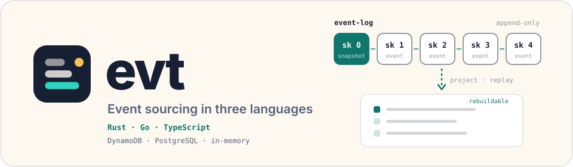
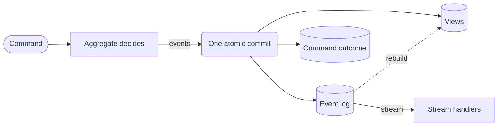

<p align="center">
  <a href="https://photon-grove.github.io/evt/">
    <picture>
      <source media="(prefers-color-scheme: dark)" srcset="docs/assets/evt-banner-dark.svg">
      
    </picture>
  </a>
</p>

<p align="center">
  <a href="https://github.com/photon-grove/evt/actions/workflows/ci.yml"></a>
  <a href="https://crates.io/crates/photon-evt"></a>
  <a href="https://docs.rs/photon-evt"></a>
  <a href="https://crates.io/crates/photon-evt-lambda"></a>
  <a href="https://pkg.go.dev/github.com/photon-grove/evt/go"></a>
  <a href="https://www.npmjs.com/package/@photon-grove/evt"></a>
  <a href="LICENSE"></a>
</p>

<p align="center">
  <a href="https://photon-grove.github.io/evt/"><b>Docs site</b></a> ·
  <a href="docs/guide/getting-started.md">Getting started</a> ·
  <a href="docs/guide/concepts.md">Concepts</a> ·
  <a href="docs/guide/examples.md">Examples</a> ·
  <a href="docs/reference/feature-matrix.md">Feature matrix</a>
</p>

evt is an event-sourcing library with three native implementations, in Rust, Go and TypeScript,
that read and write one storage format byte for byte. The record of truth is an append-only log
of immutable events, and an aggregate's state (an account, an order, a document) is whatever you
get by folding its events in order. You don't adopt a runtime or inherit from a base type. You
implement a handful of traits or interfaces and use the pieces you need.

Reach for it when the history matters as much as the current state: an audit trail you can trust,
read models you can delete and rebuild, and retries that never record the same fact twice. Because
the implementations share their storage format, Rust, Go and TypeScript services can append to the
same streams.

## Pick your language

| | Install | Status |
| --- | --- | --- |
| **Rust** · [`photon-evt`](crates/evt/README.md) | `cargo add photon-evt` | Shipping, with the most features: the core, fenced rebuilds, the sync journal, and [`photon-evt-lambda`](crates/evt-lambda/README.md) for DynamoDB Streams |
| **Go** · [`github.com/photon-grove/evt/go`](go/README.md) | `go get github.com/photon-grove/evt/go` | Shipping: the original module, with the core, fenced rebuilds and the `evt-doctor` CLI. It doesn't have the sync journal |
| **TypeScript** · [`@photon-grove/evt`](packages/evt/README.md) | `npm install @photon-grove/evt` | Shipping: the core, transactions with read fences, command outcomes, commit-wide projectors with fenced rebuilds, the view repository, the sync journal, and the in-memory, DynamoDB and PostgreSQL backends. The Lambda helpers are ported as [`@photon-grove/evt-lambda`](packages/evt-lambda/README.md), not yet on npm |

The [feature matrix](docs/reference/feature-matrix.md) tracks every capability in each language,
and a PR that changes one updates its row, so it describes the code on `main` rather than plans.

## Highlights

| Capability                            | What you get                                                                                                                            |
| ------------------------------------- | --------------------------------------------------------------------------------------------------------------------------------------- |
| **One conditional write per command** | Events, the stream's head, view rows and the command's outcome commit together, or not at all. A racing writer gets a conflict.          |
| **Three backends, one contract**      | DynamoDB (single table, `pk`/`sk`), PostgreSQL, and an in-memory store for tests. Every backend passes the same conformance suite.       |
| **Multi-stream transactions**         | Append to several aggregates in one atomic commit, with read fences on streams you only looked at.                                      |
| **Durable command outcomes**          | A retried command gets its stored answer, accepted or rejected, instead of running twice. Rejections can carry events of their own.     |
| **Views derived from events**         | Commit-wide projectors write read-model rows in the same commit as the events. Rust's and TypeScript's `ProjectionRebuild` rebuild them from the log behind a rebuild fence, and Go's `RebuildProjections` rebuilds per-entity views under the same fence. |
| **Snapshots and upcasters**           | Inline snapshots keep loads short, snapshot-verified compaction trims old history, and versioned upcasters let payloads change shape.    |
| **One format, three languages**       | Golden fixtures and live interleaved runs keep Go, Rust and TypeScript writing the same bytes. See [how it's checked](#one-format-three-languages). |
| **Realtime sync and Lambda**          | Rust and TypeScript: a per-scope sync journal with gap detection and compaction, and Lambda helpers for DynamoDB Streams handlers. |

## How a command flows

A command loads an aggregate from its stream, decides which events to emit, and commits them in
one conditional write. On DynamoDB that's a transaction that puts each event under
`pk = <entity id>` and `sk = <sequence>` and raises the stream's head item only if it still holds
the sequence the command loaded. On PostgreSQL it's one SQL transaction over the events table and
its stream-heads table. If another writer got there first, the commit fails as a conflict and
nothing is written.



With command outcomes turned on, the same commit records what the command decided, so a retry
with the same command ID gets that answer back instead of running again. Projectors can add view
rows to the commit too, so a read model stays in step with the events behind it, and every row
stays a deterministic function of the log. [Command outcomes and retries](docs/guide/commands.md),
[Projections and rebuilds](docs/guide/projections.md) and [Concepts](docs/guide/concepts.md) walk
through each piece.

## Quick start

The same counter in each language: an `Incremented` event per command, run against the in-memory
backend you'd use in tests. Swapping in the DynamoDB or PostgreSQL repository changes nothing in
the aggregate.

<details open>
<summary><b>Rust</b></summary>

```sh
cargo add photon-evt                      # add --features dynamodb or postgres for a durable backend
```

An aggregate handles commands and applies events. `domain_events!` declares the event enum with
its stored type names and versions, and the `Aggregate` trait carries the command, event and error
types. `MemRepository` runs it against an in-memory log, and `DynamoRepository` and
`PostgresRepository` sit behind the `dynamodb` and `postgres` features.

```rust
use photon_evt::{Aggregate, MemRepository, Metadata, Store, domain_events};
use serde::{Deserialize, Serialize};

#[derive(Clone, Debug, PartialEq, Serialize, Deserialize)]
pub struct Incremented {
    pub by: i64,
}

domain_events! {
    #[derive(Clone, Debug, PartialEq)]
    pub enum CounterEvent {
        Incremented(Incremented) => ("counter:incremented", 1),
    }
}

#[derive(Debug, Default, Serialize, Deserialize)]
#[serde(default)]
pub struct Counter {
    pub total: i64,
}

impl Aggregate for Counter {
    const TYPE: &'static str = "counter";

    type Command = i64;
    type Event = CounterEvent;
    type Error = std::convert::Infallible;
    type Services = ();

    async fn handle(&self, by: i64, _: &()) -> Result<Vec<CounterEvent>, Self::Error> {
        Ok(vec![Incremented { by }.into()])
    }

    fn apply(&mut self, event: CounterEvent) {
        match event {
            CounterEvent::Incremented(e) => self.total += e.by,
        }
    }
}

#[tokio::main]
async fn main() -> Result<(), Box<dyn std::error::Error>> {
    let store = Store::<Counter, _>::new(MemRepository::new(), ());
    let executed = store.execute("counter-1", 2, Metadata::new("us-west-2")).await?;
    assert_eq!(executed.state.aggregate().total, 2);
    Ok(())
}
```

`Store::execute` loads the stream, runs `handle`, and commits the events in one conditional
write. If another writer got there first, the commit fails as a conflict. The
[`photon-evt` README](crates/evt/README.md) covers transactions, command outcomes, the journal and
testing, and [`photon-evt-lambda`](crates/evt-lambda/README.md) is its AWS Lambda side.

</details>

<details>
<summary><b>Go</b></summary>

```sh
go get github.com/photon-grove/evt/go
```

The Go module has the same shape. This counter emits an `Incremented` event for each `Increment`
command, and `mem.NewStore()` runs it against an in-memory log. The durable stores are
`dynamo.NewRepository` or `postgres.NewRepository` behind `snapshots.NewStore`. A DynamoDB table is initialized once at
deploy time with `evt-doctor init` (or `repo.Initialize(ctx)`), and writers refuse an
uninitialized table rather than scan it.

```go
package main

import (
	"context"
	"encoding/json"
	"fmt"

	evt "github.com/photon-grove/evt/go"
	"github.com/photon-grove/evt/go/backends/mem"
)

type Increment struct{ By int }

func (Increment) Type() evt.CommandType      { return "counter:increment" }
func (Increment) EntityType() evt.EntityType { return "counter" }

type Incremented struct {
	ID evt.EntityID `json:"id"`
	By int          `json:"by"`
}

func (Incremented) Type() evt.EventType        { return "counter:incremented" }
func (Incremented) Version() evt.EventVersion  { return 1 }
func (Incremented) EntityType() evt.EntityType { return "counter" }
func (e Incremented) EntityID() evt.EntityID   { return e.ID }

type Counter struct {
	ID    evt.EntityID
	Total int
}

func (c *Counter) Type() evt.EntityType                { return "counter" }
func (c *Counter) GetID() evt.EntityID                 { return c.ID }
func (c *Counter) EventUpcasters() []evt.EventUpcaster { return nil }
func (c *Counter) Projectors() []evt.EventProjector    { return nil }

func (c *Counter) Handle(_ context.Context, cmd evt.Command) (evt.CommandResult, error) {
	inc, ok := cmd.(*Increment)
	if !ok {
		return evt.CommandResult{}, evt.NewBadCommandError(cmd)
	}
	return evt.CommandResult{Events: []evt.Event{Incremented{ID: c.ID, By: inc.By}}}, nil
}

func (c *Counter) Apply(event evt.Event) error {
	c.Total += event.(Incremented).By
	return nil
}

func (c *Counter) DeserializeEvent(e evt.SerializedEvent) (evt.Event, error) {
	var event Incremented
	err := json.Unmarshal(e.Payload, &event)
	return event, err
}

func main() {
	ctx := context.Background()
	store := mem.NewStore()

	counter := &Counter{ID: "counter-1"}
	if err := store.Execute(ctx, counter, "counter-1", &Increment{By: 2}, evt.Metadata{}); err != nil {
		panic(err)
	}

	// LoadAggregate replays the stream into a fresh instance and returns its CommandContext.
	reloaded := &Counter{ID: "counter-1"}
	cc, err := store.LoadAggregate(ctx, reloaded, "counter-1")
	if err != nil {
		panic(err)
	}
	fmt.Println(reloaded.Total, *cc.CurrentSequence) // 2 1
}
```

`Execute` replays history onto the instance you pass, so give it a fresh one per command. The
`CommandContext` that `LoadAggregate` returns is where the stream stood when it was loaded, and
it's what a commit checks against. [`go/examples/banking`](go/examples/banking) is a fuller
version with conflicts and not-found errors, and [`go/README.md`](go/README.md) lists the
packages. This program runs in CI exactly as written.

</details>

<details>
<summary><b>TypeScript</b></summary>

```sh
npm install @photon-grove/evt
```

`defineEvents` gives each event type a version and a codec, and `defineAggregate` ties the events
to a state codec, an initial state, `handle` and `apply`. `handle` returns a decision, accept with
events or reject with a code, and `apply` returns the next state. The event's type and payload JSON
match the Rust counter's, so either language could read this stream.

```ts
import {Store, defineAggregate, defineEvents, json} from '@photon-grove/evt'
import {MemRepository} from '@photon-grove/evt/memory'

const counterEvents = defineEvents({
  'counter:incremented': {version: 1, codec: json<{by: number}>()},
})

const counter = defineAggregate({
  type: 'counter',
  events: counterEvents,
  state: json<{total: number}>(),
  initial: () => ({total: 0}),

  handle: (_state, by: number) => ({
    kind: 'accept',
    events: [{type: 'counter:incremented', data: {by}}],
  }),

  apply: (state, event) => ({total: state.total + event.data.by}),
})

const store = new Store(new MemRepository())
await store.execute(counter, 'counter-1', 2)

const loaded = await store.load(counter, 'counter-1')
console.log(loaded.state.total, loaded.sequence) // 2 1n
```

The package is ESM only, with no runtime dependencies, and CI runs it on Node, Bun and Deno.
Sequences are `bigint`s because Go and Rust store them as 64-bit integers. The
[package README](packages/evt/README.md) covers the DynamoDB and PostgreSQL repositories,
transactions and command outcomes, and the getting started guide's
[TypeScript walkthrough](docs/guide/getting-started.md#the-same-model-in-typescript) builds a bank
account end to end.

</details>

## One format, three languages

evt isn't one library with bindings. Each language is a native implementation of the
[storage format](docs/reference/storage-format.md), which is normative: the DynamoDB items,
PostgreSQL rows, event and metadata JSON, snapshots, outcome rows and stream envelopes, down to the
byte. Three things hold the implementations to it:

- **Golden fixtures.** [`compat/fixtures`](compat/) holds encode and decode vectors, scenario
  outputs and exact DynamoDB requests. Go generates most of them and Rust generates its extensions'
  (the journal and Lambda), and nobody edits them by hand. TypeScript checks itself against every
  one of them.
- **Live interleaved runs.** Go and Rust take turns writing the same streams in local DynamoDB and
  PostgreSQL, then both verify every stream. The TypeScript driver joins those runs for every
  scenario, standing in for Go and then for Rust.
- **Conformance suites.** Each language has a backend-neutral conformance suite, and every
  repository it ships passes it on the in-memory store, DynamoDB and PostgreSQL.

## Examples

Every example compiles and runs in CI. [The examples page](docs/guide/examples.md) lists them all
with their run commands.

| Example | Rust | Go | TypeScript |
| --- | --- | --- | --- |
| Getting started: the guide's bank account, end to end | [`getting_started.rs`](crates/evt/examples/getting_started.rs) | — | [`getting-started.ts`](packages/evt/examples/getting-started.ts) |
| Banking: commands, conflicts, not-found errors | [`banking.rs`](crates/evt/examples/banking.rs) | [`go/examples/banking`](go/examples/banking) | — |
| Todo: a commit-wide projector, its rows replayed from the log | [`todo.rs`](crates/evt/examples/todo.rs) | [`go/examples/todo`](go/examples/todo) | — |
| Transfer: two accounts in one commit (the Go version also replays retries from stored outcomes) | in [`banking.rs`](crates/evt/examples/banking.rs) | [`go/examples/transfer`](go/examples/transfer) | — |
| Sync journal: scopes, high watermark, gap-checked paging | [`journal.rs`](crates/evt/examples/journal.rs) | — | — |
| Lambda: a DynamoDB Streams batch with partial batch failures | [`stream_handler.rs`](crates/evt-lambda/examples/stream_handler.rs) | — | — |

## Documentation

| | |
| --- | --- |
| **Learn** | [Getting started](docs/guide/getting-started.md) · [Concepts](docs/guide/concepts.md) · [Examples](docs/guide/examples.md) |
| **Build** | [Projections and rebuilds](docs/guide/projections.md) · [Command outcomes and retries](docs/guide/commands.md) · [Streams and projectors](docs/guide/streams.md) · [Integration cookbook](docs/guide/integration.md) |
| **Backends** | [DynamoDB](docs/guide/dynamodb.md) · [PostgreSQL](docs/guide/postgres.md) |
| **Upgrade** | [Upgrading to v0.9](docs/guide/upgrading-to-v0.9.md) · [Migrating to stream heads](docs/guide/migrating-to-stream-heads.md) |
| **Reference** | [Storage format](docs/reference/storage-format.md) (normative) · [Feature matrix](docs/reference/feature-matrix.md) · [Architecture decisions](docs/adr/) |

The same pages are on the [docs site](https://photon-grove.github.io/evt/), with a concepts tour
in all three languages, interactive architecture diagrams, and a parity grid read from the feature
matrix.

## What's in the repo

| Path | What it is |
| --- | --- |
| [`crates/`](crates/) | `photon-evt`, `photon-evt-lambda`, and `evt-compat`, the cross-language test harness |
| [`go/`](go/) | The Go module `github.com/photon-grove/evt/go`, tagged `go/vX.Y.Z` because Go requires that prefix for a module in a subdirectory |
| [`packages/evt`](packages/evt/) | The TypeScript package `@photon-grove/evt`, with its fixture runner in `packages/evt-compat` |
| [`packages/evt-lambda`](packages/evt-lambda/) | `@photon-grove/evt-lambda`, the TypeScript port of `photon-evt-lambda` |
| [`compat/`](compat/) | Shared scenarios and golden fixtures that hold every language to the same bytes |
| [`docs/`](docs/) | The guide, the reference, and the architecture decision records |
| [`website/`](website/), [`packages/react-flow-diagrams`](packages/react-flow-diagrams/) | The docs site and the diagram package it uses |

## Contributing

Issues and pull requests are welcome. [CONTRIBUTING.md](CONTRIBUTING.md) explains how to build and
test locally, including the DynamoDB and PostgreSQL integration suites, and
[SECURITY.md](SECURITY.md) explains how to report a vulnerability privately.

## License

Apache-2.0. See [`LICENSE`](LICENSE).

Built by [Photon Grove](https://photon-grove.com), a Colorado software studio.
