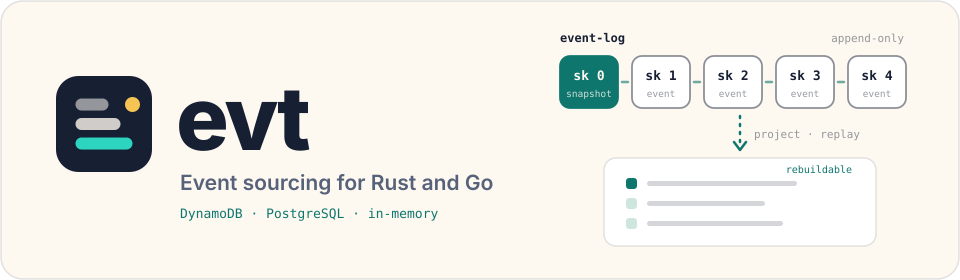
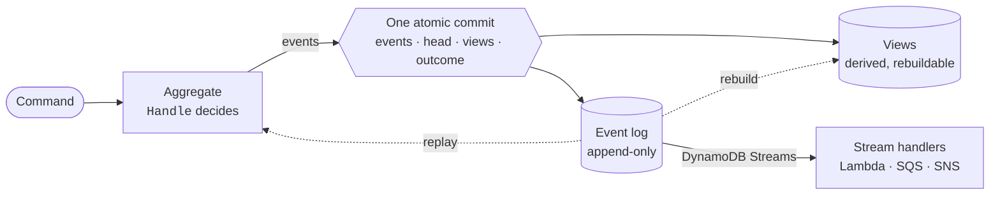

<p align="center">
  <a href="https://photon-grove.github.io/evt/">
    <picture>
      <source media="(prefers-color-scheme: dark)" srcset="docs/assets/evt-banner-dark.svg">
      
    </picture>
  </a>
</p>

<p align="center">
  <a href="https://github.com/photon-grove/evt/actions/workflows/ci.yml"></a>
  <a href="https://pkg.go.dev/github.com/photon-grove/evt/go"></a>
  <a href="https://crates.io/crates/photon-evt"></a>
  <a href="https://docs.rs/photon-evt"></a>
  <a href="https://crates.io/crates/photon-evt-lambda"></a>
  <a href="LICENSE"></a>
</p>

<p align="center">
  <a href="https://photon-grove.github.io/evt/"><b>Docs site</b></a> ·
  <a href="docs/guide/getting-started.md">Getting started</a> ·
  <a href="docs/guide/concepts.md">Concepts</a> ·
  <a href="docs/guide/examples.md">Examples</a> ·
  <a href="docs/reference/feature-matrix.md">Feature matrix</a>
</p>

evt is an event-sourcing library for Go, with a native Rust implementation that reads and writes
the same log. The record of truth is an append-only log of events, and an aggregate's state (an
account, an order, a document) is whatever you get by folding its events in order. You don't adopt
a runtime or inherit from a base type. You implement a handful of interfaces and use the packages
you need.

Reach for it when the history matters as much as the current state: an audit trail you can trust,
read models you can delete and rebuild, and retries that never record the same fact twice. Because
the Go and Rust code share one storage format byte for byte, a Go service and a Rust service can
append to the same streams.

## Highlights

|                                       |                                                                                                                                         |
| ------------------------------------- | --------------------------------------------------------------------------------------------------------------------------------------- |
| **One conditional write per command** | Events, the stream's head, view rows and the command's outcome commit together, or not at all. A racing writer gets a conflict.          |
| **Three backends, one contract**      | DynamoDB (single table, `pk`/`sk`), PostgreSQL, and an in-memory store for tests. Every backend passes the same conformance suite.       |
| **Multi-stream transactions**         | Append to several aggregates in one atomic commit, with read fences on streams you only looked at.                                      |
| **Durable command outcomes**          | A retried command gets its stored answer, accepted or rejected, instead of running twice. Rejections can carry events of their own.     |
| **Views you can rebuild**             | Projectors write read-model rows in the same commit as the events. Wipe a view table and replay the log to get it back.                 |
| **Snapshots and upcasters**           | Inline snapshots keep loads short, snapshot-verified compaction trims old history, and versioned upcasters let payloads change shape.    |
| **Go and Rust, wire-compatible**      | Golden fixtures and live interleaved runs keep both languages writing the same bytes. See the [feature matrix](docs/reference/feature-matrix.md). |
| **Realtime sync and Lambda (Rust)**   | A per-scope sync journal with gap detection and compaction, and `photon-evt-lambda` for DynamoDB Streams handlers.                       |

## How a command flows

A command loads an aggregate from its stream, decides which events to emit, and commits them in
one conditional write. On DynamoDB that's a transaction that puts each event under
`pk = <entity id>` and `sk = <sequence>` and raises the stream's head item only if it still holds
the sequence the command loaded. On PostgreSQL it's one SQL transaction over the events table and
its stream-heads table. If another writer got there first, the commit fails as a conflict and
nothing is written.



Projectors can add view rows to that same commit, so a read model stays in step with the events
behind it, and a rebuild can reproduce it from the log. [Concepts](docs/guide/concepts.md) walks
through each piece.

## Quick start: Go

```sh
go get github.com/photon-grove/evt/go
```

An aggregate handles commands and applies events. This counter emits an `Incremented` event for
each `Increment` command, and `mem.NewStore()` runs it against an in-memory log, which is what
you'd use in tests. Swapping in `dynamo.NewRepository` or `postgres.NewRepository` behind
`snapshots.NewStore` changes nothing in the aggregate. A DynamoDB table is initialized once at
deploy time with `evt-doctor init` (or `repo.Initialize(ctx)`), and writers refuse an
uninitialized table rather than scan it.

```go
package main

import (
	"context"
	"encoding/json"
	"fmt"

	evt "github.com/photon-grove/evt/go"
	"github.com/photon-grove/evt/go/backends/mem"
)

type Increment struct{ By int }

func (Increment) Type() evt.CommandType      { return "counter:increment" }
func (Increment) EntityType() evt.EntityType { return "counter" }

type Incremented struct {
	ID evt.EntityID `json:"id"`
	By int          `json:"by"`
}

func (Incremented) Type() evt.EventType        { return "counter:incremented" }
func (Incremented) Version() evt.EventVersion  { return 1 }
func (Incremented) EntityType() evt.EntityType { return "counter" }
func (e Incremented) EntityID() evt.EntityID   { return e.ID }

type Counter struct {
	ID    evt.EntityID
	Total int
}

func (c *Counter) Type() evt.EntityType                { return "counter" }
func (c *Counter) GetID() evt.EntityID                 { return c.ID }
func (c *Counter) EventUpcasters() []evt.EventUpcaster { return nil }
func (c *Counter) Projectors() []evt.EventProjector    { return nil }

func (c *Counter) Handle(_ context.Context, cmd evt.Command) (evt.CommandResult, error) {
	inc, ok := cmd.(*Increment)
	if !ok {
		return evt.CommandResult{}, evt.NewBadCommandError(cmd)
	}
	return evt.CommandResult{Events: []evt.Event{Incremented{ID: c.ID, By: inc.By}}}, nil
}

func (c *Counter) Apply(event evt.Event) error {
	c.Total += event.(Incremented).By
	return nil
}

func (c *Counter) DeserializeEvent(e evt.SerializedEvent) (evt.Event, error) {
	var event Incremented
	err := json.Unmarshal(e.Payload, &event)
	return event, err
}

func main() {
	ctx := context.Background()
	store := mem.NewStore()

	counter := &Counter{ID: "counter-1"}
	if err := store.Execute(ctx, counter, "counter-1", &Increment{By: 2}, evt.Metadata{}); err != nil {
		panic(err)
	}

	// LoadAggregate replays the stream into a fresh instance and returns its CommandContext.
	reloaded := &Counter{ID: "counter-1"}
	cc, err := store.LoadAggregate(ctx, reloaded, "counter-1")
	if err != nil {
		panic(err)
	}
	fmt.Println(reloaded.Total, *cc.CurrentSequence) // 2 1
}
```

`Execute` replays history onto the instance you pass, so give it a fresh one per command. The
`CommandContext` that `LoadAggregate` returns is where the stream stood when it was loaded, and
it's what a commit checks against. [`go/examples/banking`](go/examples/banking) is a fuller
version with conflicts and not-found errors, and [`go/README.md`](go/README.md) lists the
packages. This program runs in CI exactly as written.

## Quick start: Rust

```sh
cargo add photon-evt                      # add --features dynamodb or postgres for a durable backend
```

The Rust side has the same shape. `domain_events!` declares the event enum with its stored type
names and versions, and the `Aggregate` trait carries the command, event and error types.

```rust
use photon_evt::{Aggregate, MemRepository, Metadata, Store, domain_events};
use serde::{Deserialize, Serialize};

#[derive(Clone, Debug, PartialEq, Serialize, Deserialize)]
pub struct Incremented {
    pub by: i64,
}

domain_events! {
    #[derive(Clone, Debug, PartialEq)]
    pub enum CounterEvent {
        Incremented(Incremented) => ("counter:incremented", 1),
    }
}

#[derive(Debug, Default, Serialize, Deserialize)]
#[serde(default)]
pub struct Counter {
    pub total: i64,
}

impl Aggregate for Counter {
    const TYPE: &'static str = "counter";

    type Command = i64;
    type Event = CounterEvent;
    type Error = std::convert::Infallible;
    type Services = ();

    async fn handle(&self, by: i64, _: &()) -> Result<Vec<CounterEvent>, Self::Error> {
        Ok(vec![Incremented { by }.into()])
    }

    fn apply(&mut self, event: CounterEvent) {
        match event {
            CounterEvent::Incremented(e) => self.total += e.by,
        }
    }
}

#[tokio::main]
async fn main() -> Result<(), Box<dyn std::error::Error>> {
    let store = Store::<Counter, _>::new(MemRepository::new(), ());
    let executed = store.execute("counter-1", 2, Metadata::new("us-west-2")).await?;
    assert_eq!(executed.state.aggregate().total, 2);
    Ok(())
}
```

`Store::execute` loads the stream, runs `handle`, and commits the events with the same optimistic
check the Go store makes. The [`photon-evt` README](crates/evt/README.md) covers transactions,
command outcomes, the journal and testing, and
[`photon-evt-lambda`](crates/evt-lambda/README.md) is its AWS Lambda side.

## Examples

Every example compiles and runs in CI. [The examples page](docs/guide/examples.md) lists them all
with their run commands.

| Example | Go | Rust |
| --- | --- | --- |
| Banking: open, deposit, withdraw, conflicts | [`go/examples/banking`](go/examples/banking) | [`crates/evt/examples/banking.rs`](crates/evt/examples/banking.rs) |
| Sync journal: scopes, high watermark, paging | — | [`crates/evt/examples/journal.rs`](crates/evt/examples/journal.rs) |

## Documentation

| | |
| --- | --- |
| **Learn** | [Getting started](docs/guide/getting-started.md) · [Concepts](docs/guide/concepts.md) · [Examples](docs/guide/examples.md) |
| **Build** | [Projections and rebuilds](docs/guide/projections.md) · [Command outcomes and retries](docs/guide/commands.md) · [Streams and projectors](docs/guide/streams.md) · [Integration cookbook](docs/guide/integration.md) |
| **Backends** | [DynamoDB](docs/guide/dynamodb.md) · [PostgreSQL](docs/guide/postgres.md) |
| **Upgrade** | [Upgrading to v0.9](docs/guide/upgrading-to-v0.9.md) · [Migrating to stream heads](docs/guide/migrating-to-stream-heads.md) |
| **Reference** | [Storage format](docs/reference/storage-format.md) (normative) · [Feature matrix](docs/reference/feature-matrix.md) · [Architecture decisions](docs/adr/) |

The same pages, with interactive architecture diagrams, are on the
[docs site](https://photon-grove.github.io/evt/).

## What's in the repo

| Path | What it is |
| --- | --- |
| [`go/`](go/) | The Go module `github.com/photon-grove/evt/go`, tagged `go/vX.Y.Z` because Go requires that prefix for a module in a subdirectory |
| [`crates/`](crates/) | `photon-evt`, `photon-evt-lambda`, and `evt-compat`, the cross-language test harness |
| [`compat/`](compat/) | Shared scenarios and golden fixtures that keep the two languages writing the same bytes |
| [`docs/`](docs/) | The guide, the reference, and the architecture decision records |
| [`website/`](website/), [`packages/`](packages/) | The docs site and the diagram package it uses |

## Contributing

Issues and pull requests are welcome. [CONTRIBUTING.md](CONTRIBUTING.md) explains how to build and
test locally, including the DynamoDB and PostgreSQL integration suites, and
[SECURITY.md](SECURITY.md) explains how to report a vulnerability privately.

## License

Apache-2.0. See [`LICENSE`](LICENSE).

Built by [Photon Grove](https://photon-grove.com), a Colorado software studio.
