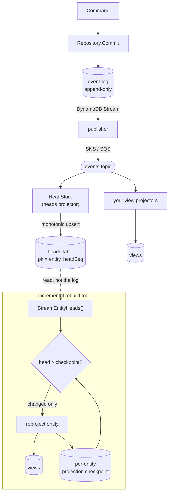

# Projections and Rebuilds

Projection rows are deterministic read models derived from immutable events.

Use `evt.RebuildProjections` when:

- a projector bug wrote incorrect view rows
- a new view is added for existing aggregate streams
- a view payload schema changes
- an operator wants to validate projection health against the event log

During a rebuild, the repository streams entities, the caller-supplied replay
function reconstitutes aggregate state, and projectors produce transaction
groups. In dry-run mode, `evt` reports the work without writing rows.

The rebuild contract deliberately makes writes explicit through `CommitGroup` so
adopters can choose the safest commit strategy for their storage backend.

## Commit-wide projectors

An `EventProjector` sees one entity at a time. A **commit-wide projector** (v0.9, C7) is a pure
function over everything one commit wrote, and it emits **view operations** that commit in the same
transaction as the events. Use it for read models that span entities: a directory of unique names,
a per-tenant ledger, an index that must never disagree with the streams behind it.

The example is a directory of unique handles. Each handle name is a stream of its own,
`handle:<name>`, and the handle stream owns the row for that name for good. A command that claims a
name reads the handle stream and appends a `handle:claimed` event to it in the same transaction as
the account's event; two accounts racing for one name both read the handle stream at one sequence,
so one loses to optimistic concurrency and retries against the new state. Releasing a name appends
`handle:released`, and the row is rewritten with a tombstone, never deleted.

```go
type handles struct{}

func (handles) Name() string { return "handles" }

// The directory reads the events of handle streams, so it is history-dependent on that type.
func (handles) History() []evt.EntityType { return []evt.EntityType{"handle"} }

func (handles) ProjectCommit(_ context.Context, commit evt.CommitView) ([]evt.ViewOperation, error) {
    var operations []evt.ViewOperation

    for _, stream := range commit.Streams { // ascending by entity ID bytes
        if stream.EntityType != "handle" {
            continue // an account stream appears by ID and type only: it is not declared
        }

        latest := stream.Events[len(stream.Events)-1] // this commit's events, ascending by sequence

        // The row's owner is the handle stream. A release is a tombstone put, not a delete: the
        // row stays where the stream put it, so the next claimant, a later commit of the same
        // stream, rewrites it.
        operations = append(operations,
            evt.PutView("handles", nameOf(stream.EntityID), stream.EntityID, stream.EntityType, holderOf(latest)))
    }

    return operations, nil
}

store := snapshots.NewStore(repo, 5).WithCommitProjectors(handles{})
```

**What a projector sees.** An `evt.CommitView`: the commit ID and every stream the commit wrote,
ascending by entity-ID bytes, each with its entity type, the commit's events for it, and its state
after the commit (the JSON its snapshot would carry). Streams that were only read are fenced, not
written, so they are not in the view. A command that writes no event — a plain rejection, an
accepted no-op — runs no projector; a rejection that carries events projects them like an accepted
command's. The view has no outcome context on purpose: a rebuild has no outcome row.

**Current-state or history-dependent.** `History()` names the entity types whose *events* the
projector reads, and the view each kind is given is what a rebuild of that kind can give it again:

- A projector that returns none is **current-state**. It is given each stream's state after the
  commit, and nothing else: no events and an **empty commit ID**, so it cannot key a row by commit,
  count a commit's events, or otherwise depend on anything beyond the state the streams reach. Use
  it for rows that are a function of current state, such as a per-entity summary.
- A projector that returns types is **history-dependent**. It is given the commit ID, and the events
  *and state* of the streams of those types only; every other stream appears by entity ID and type
  with neither (its history may have been compacted, and the declaration does not cover it). Before
  the first commit that runs it the store durably adds those types to the feature manifest's
  `historyDependent` set, so `CompactBelow` refuses them in every process — the commits a rebuild
  replays must stay. The repository must be able to declare (`evt.HistoryDeclarer`; the in-memory,
  DynamoDB, and PostgreSQL repositories are) or the commit fails with
  `*evt.HistoryDeclarationUnsupportedError`.

**Owners.** Every operation of every projector names the stream that **owns** its row (the owner is
an argument of `PutView` and `DeleteView`). It must be a stream the commit wrote; for a
history-dependent projector it must also be of a type the projector declares in `History()`, so the
row can be rebuilt from the history the declaration protects (`*evt.InvalidViewOperationError`
otherwise). The repository stores the owner as the row's `entityID` and conditions **every** write
to the row on it — puts and deletes, with or without a presence condition — so a write by any
other stream fails the commit with a `*evt.ProjectorOperationError` (reason
`ConditionalCheckFailed`) at the time it is made, not at a later rebuild.

**A row's owner must never change.** The log keeps one commit order only: each stream's sequence
order. The writes to a row can be put back in order only while they all come from commits that
wrote the same stream. A key therefore never changes hands by delete-then-put from another stream:
the delete leaves the row absent, so the second stream's put would pass the owner condition live,
and a rebuild — which has no order between the two streams — could not tell which came last
(`evt.ReplayViews` refuses it with `*evt.SharedViewKeyError`). To reuse a key, keep it with its
owner and rewrite the row as a tombstone, or make the key belong to a stream every claimant writes,
as the handle stream above does. Do not rely on commit IDs for ordering; they are not causal.

Even a delete that finds nothing counts as a claim on the key. A delete by owner A of a row that is
not there, followed by a put by owner B, is accepted live (the row is absent, so the owner
condition holds) but refused on replay, because the replay sees two owners touch one row. Treat
every delete as a claim, whether or not it removes a row.

**What it returns.** Puts and deletes of rows at any `pk`/`sk`, in the order they should be
written. A put overwrites unless it is `IfAbsent`; a delete of a missing row succeeds unless it is
`IfPresent`. `OnConflict(err)` names the error to return when the condition fails. Projectors are
appended in the order `WithCommitProjectors` was called, each one's operations in emission order,
after the marker check and before the written streams ([layout](spec/storage-format.md#writes)).
Before any write, on every backend, the engine refuses an operation with an empty or non-UTF-8 key,
a `pk` over 2,048 or an `sk` over 1,024 UTF-8 bytes (`*evt.ViewKeyTooLongError`), and two
operations on the same row (`*evt.DuplicateViewKeyError`). Operations count against the
`CommitTooLarge` budget, and a commit that carries operations but no event is refused
(`*evt.ProjectorOnlyCommitError`): views are projections of committed events.

**Where the rows go.** The repository writes them. Give the DynamoDB repository a views table
with `repo.WithViewsTable("views")` (string `pk` and `sk`, the same table `NewViewRepository`
reads); give the PostgreSQL repository a writer with `repo.WithViewWriter(fn)`, since evt defines
no view schema — your `fn` turns each operation into the SQL for your own table (see
[PostgreSQL](postgres.md#views)). The in-memory repository keeps them for tests
(`mem.Repository.View`, `Views`). Without a place to write, the commit fails with
`*evt.ViewsNotConfiguredError` before any write; operations are never dropped.

**When a condition fails.** The commit writes nothing and returns `*evt.ProjectorOperationError`,
which names the projector and the operation (and wraps the operation's mapped error, so
`errors.Is(err, ErrHandleTaken)` works). It is not an optimistic-concurrency conflict and not
transient: re-preparing the command cannot fix it, so fence-aware retry returns it at once and
records no outcome. It ranks last among the ways a commit can fail: a lost outcome row, stream-head
drift, a sequence gap, and any conflict on a written stream or a fence are reported first.

**Purity is the rebuild contract.** A projector's rows must be a deterministic function of its
`CommitView`: no clock, random source, environment, or store reads; no state kept between calls; no
dependence on map iteration order. Mutable decisions, externally observed signals, and verdicts are
event-sourced first and projected second; a view row that exists only because something happened
outside the log cannot be rebuilt, and a rebuild would silently lose it.

**What a rebuild reproduces today.** Only an in-memory replay exists: regroup the stored events
with `evt.GroupCommits`, fold each stream's state after its commit yourself, and run the projectors
over the groups with `evt.ReplayViews`. For a **history-dependent** projector that is the contract
— the rows it returns equal the live rows — and it is how to test one (see the end-to-end test in
`snapshots/projectors_test.go`). For a **current-state** projector the same replay works because
the state is yours to supply, but there is no engine entry point yet that rebuilds current-state
rows from the current state of the streams alone (the state-based rebuild is specified in the
[storage format](spec/storage-format.md#views) and lands with the rebuild ports); until then,
treat a current-state projector's rows as reproducible only by replaying with folded state.
Nothing rebuilds the rows of a durable view table by itself today.

```go
groups, err := evt.GroupCommits(storedEvents) // ordered consistently with every stream's sequence
for _, group := range groups {
    for i, stream := range group.Streams {
        group.Streams[i].State = foldState(storedEvents, stream) // the state after this commit
    }
}

rows, err := evt.ReplayViews(ctx, projectors, groups)
// rows must equal the live rows, or err is *evt.SharedViewKeyError: the replay refuses a row two
// streams write instead of guessing the order.
```

## Scanning the event log

`RebuildProjections` reads the whole event log through `StreamEntities`, which is
backed by a DynamoDB `Scan`. A `Scan` makes no ordering guarantees, so
`StreamEntities` groups every matched event by entity and applies each entity's
events in sequence order before yielding it. As a result it buffers the matched
events in memory for the duration of the scan — it is a rebuild/diagnostic path,
not a hot read path.

For large tables, configure a parallel scan on the DynamoDB repository before
passing it to `RebuildProjections`:

```go
repo := dynamo.NewRepository(client, eventsTable).WithScanSegments(8)
res, err := evt.RebuildProjections(ctx, repo, applyEvent, cfg)
```

`WithScanSegments(n)` sweeps the table with `n` parallel segments, trading higher
read throughput (and consumed capacity) for a faster rebuild. Leave it at the
default (a single sequential scan) for small tables.

### Bounded-memory rebuilds for large tables

*Deprecated in v0.9.0 ([ADR 0006](adr/0006-parity-policy-and-feature-cuts.md), K3):*
`StreamEntitiesByQuery`, its workers/`HeadSource` options, and `RebuildProjectionsByQuery` are
cut — **removed without a bounded-memory in-library replacement**. `StreamEntities` (the source
behind `evt.RebuildProjections` and `evt.RebuildProjectionsFromStream`) buffers every matched
event, so for large tables page your own DynamoDB Query/Scan with `LastEvaluatedKey` (one
partition query per entity keeps memory bounded) and feed `evt.RebuildProjectionsFromStream`
yourself. The section below documents the deprecated path for pre-v0.9 readers.

Because `StreamEntities` must regroup an unordered scan, it holds the matched
events in memory until the scan finishes. For large event logs, use the dynamo
repository's `StreamEntitiesByQuery`, which first enumerates the distinct entity
IDs with a key-only scan (`ProjectionExpression` on `pk`) and then queries each
entity's partition — returning its events already in order — folding and emitting
one entity at a time. Memory is bounded to the set of entity IDs plus a worker
pool of in-flight aggregates, and entities stream out as they are rebuilt. Pass
the resulting stream to `RebuildProjectionsFromStream`:

```go
repo := dynamo.NewRepository(client, eventsTable)
stream := repo.StreamEntitiesByQuery(ctx, dynamo.StreamByQueryOptions{
    EntityType: cfg.EntityType, // optional filter
    Workers:    8,              // partitions queried concurrently
    // Skip lets you resume an interrupted run; rebuilds are idempotent, so a
    // full restart is also always safe.
    Skip: func(id evt.EntityID) bool { return false },
}, applyEvent)

res, err := evt.RebuildProjectionsFromStream(ctx, stream, cfg)
```

`RebuildProjections` is the convenience wrapper that builds the scan-based stream
for you; `RebuildProjectionsFromStream` accepts any entity stream so you can pick
the strategy that fits your table size.

Note on cost: enumeration is still a table `Scan`. A `ProjectionExpression`
reduces the data returned over the wire but **not** the read capacity consumed —
DynamoDB charges scan RCUs by the size of the items read, not the attributes
projected. So enumeration consumes read capacity comparable to scanning the full
log; the win here is bounded memory, incremental output, and parallel per-entity
queries, not lower read cost. For genuinely cheaper, constant-memory enumeration,
back it with a heads registry — see [Constant-memory enumeration](#constant-memory-enumeration)
below.

### Incremental rebuilds with an entity-heads table

*Deprecated in v0.9.0 ([ADR 0006](adr/0006-parity-policy-and-feature-cuts.md), K4):* the heads
table and `dynamo.HeadStore` are cut — derive heads from the log with `StreamEntityHeads`
instead, and rebuild changed entities against a per-entity checkpoint you maintain yourself.
This section documents the pre-v0.9 setup for readers still on it.

A full rebuild reprocesses every entity even when only a handful changed since the
last run, and (per the note above) enumeration reads capacity comparable to the
whole log. To rebuild only what changed, keep a small **heads table**: one row per
entity (`pk` = entity ID) holding that entity's highest event sequence. Reading it
is a scan of a few small rows, not the event log, so change detection is cheap.

The heads table is maintained like any other read model — by a projector on the
[events topic](streams.md) — so it adds nothing to the commit path, and its per-entity-keyed
writes stay distributed (no hot partition, no global counter, no secondary index).



`dynamo.HeadStore` plays both projector and reader roles. Putting the pieces
together:

**1. Provision the heads table** — one attribute, the partition key (`pk`); no sort
key, no index. `entityType` is a plain attribute the reader filters on, not a key.

**2. Maintain it with a projector Lambda**, subscribed to the same events topic your
other projectors use. The upsert is monotonic, so re-deliveries and out-of-order
events fail the condition and are no-ops — durable idempotency is optional:

```go
heads := dynamo.NewHeadStore(client, "my-entity-heads")
runtime := projectors.NewRuntime(heads, projectors.NewInMemoryIdempotencyGuard(), logger)
// runtime.Process(ctx, records) from your SNS/SQS handler — see streams.md.
```

**3. Seed it once** from the existing log before the first incremental run, so
entities that predate the projector are present. `Backfill` takes any
`EntityHeadStreamer` source — typically a `Repository`, whose `StreamEntityHeads`
folds the log (the one place a full scan remains). Call once per entity type to
record the type on each row:

```go
for _, t := range myEntityTypes {
    if _, err := heads.Backfill(ctx, repo, t); err != nil { /* ... */ }
}
```

**4. Detect and reproject** in the rebuild tool: read every head, compare against a
per-entity projection checkpoint you store alongside your views (the sequence each
view was last built from), and reproject only the entities whose head moved.

```go
current, err := heads.StreamEntityHeads(ctx, "") // all types; few-MB scan
// for id, head := range current:
//   if head > checkpoint[id] { reproject(id); checkpoint[id] = head }
```

Compare with `>`, not `!=`: heads only advance, so a strictly-greater test reprojects
exactly the entities that moved. It also keeps detection correct under the eventually
consistent read above — a stale head that briefly reads *behind* the checkpoint is
simply skipped, never regressing the checkpoint or forcing a redundant reprojection.

The reader is eventually consistent by default (half the RCU cost); a head that lags
a beat only defers an entity to the next rebuild, never skips it. Derive a strongly
consistent variant with `heads.WithConsistentRead(true)` if a read must reflect the
latest projector write.

**Recovering a lagged head.** The heads table is a projection, so it is only as
current as its projector. If a delivery is permanently dropped (for example, a record
exhausted its retries and went to a dead-letter queue), that entity's head can lag the
log, and change detection would treat it as unchanged and skip its reprojection. The
fix is the same operation that seeds the table: re-run `Backfill` from the log, whose
heads are authoritative. Because the upsert is monotonic, backfill only ever advances a
lagging head and is safe to run anytime — concurrently with the live projector and as
often as you like — so a periodic backfill (or one after draining a DLQ) keeps the
table from drifting.

`EntityHeadStreamer` is backend-neutral, so a non-DynamoDB backend can satisfy it
its own way (for example, a SQL backend with `SELECT entity_id, MAX(sequence) …`).
The in-memory repository implements it directly over its event map for tests. The
head accounts for a compacted stream's snapshot floor, so it stays correct after
`CompactBelow`.

#### Constant-memory enumeration

*Deprecated in v0.9.0 (K3/K4):* the `HeadSource` option, `StreamEntitiesByQuery`, and
`RebuildProjectionsByQuery` below are cut — the scan-and-dedup enumeration through
`StreamEntities`/`StreamEntitiesFromSnapshotsWithOptions` is the supported path.

`StreamEntityHeads` returns a `map[EntityID]EventSequence` — convenient, but the
map grows with the number of entities, so a rebuild's memory ceiling scales with
the table. For a genuinely constant-memory pass, `HeadStore` also implements the
streaming `evt.EntityHeadVisitor`:

```go
err := heads.StreamEntityHeadsFunc(ctx, "", func(id evt.EntityID, head evt.EventSequence) error {
    if head > checkpoint(id) { // your per-entity projection checkpoint
        reproject(id)
    }
    return nil // return an error to stop enumeration early
})
```

This pages the heads table and invokes the callback once per row. One row per
entity means no dedup set is needed, unlike an event-log scan. `EntityHeadVisitor`
is backend-neutral, so a SQL backend can stream a cursor over
`SELECT entity_id, MAX(sequence) …`.

To drive a bounded-memory **rebuild** from the registry instead of a scan, set
`StreamByQueryOptions.HeadSource` (any `EntityHeadVisitor`, e.g. a `HeadStore`):

```go
stream := repo.StreamEntitiesByQuery(ctx, dynamo.StreamByQueryOptions{
    Workers:    8,
    HeadSource: heads, // enumerate IDs from the registry, not a key-only event-log scan
}, applyEvent)
```

With `HeadSource`, IDs stream from the registry to workers without a dedup set;
each entity's events still come from its event-log partition. This opt-in path
requires a projector-maintained, `Backfill`-seeded heads table. Leave it nil for
scan-and-dedup enumeration. The scan path reports enumeration errors before output,
while the registry can report an error after emitting entities. Rerun or resume with
`Skip`.

To skip the hand-wiring entirely, the dynamo repository's
`RebuildProjectionsByQuery` builds the `StreamEntitiesByQuery` stream — registry or
scan — and feeds it to `RebuildProjectionsFromStream` for you. It is the
bounded-memory counterpart to `evt.RebuildProjections`:

```go
res, err := repo.RebuildProjectionsByQuery(ctx, dynamo.StreamByQueryOptions{
    Workers:    8,
    HeadSource: heads, // omit to use the scan-and-dedup enumeration instead
}, applyEvent, cfg)
```

Set `cfg.EntityType` to scope the rebuild: when `StreamByQueryOptions.EntityType`
is empty it inherits `cfg.EntityType`, so the type is declared once and scopes
enumeration too. (Setting both to different types is rejected, since the stream
would enumerate one type while the rebuild's per-entity check skips it as another.)
This wrapper covers the scan-vs-registry choice; for streams truncated by
`CompactBelow`, stay on `evt.RebuildProjections` with `RebuildConfig.SeedEntity` —
see [Rebuilding compacted streams](#rebuilding-compacted-streams).

## Rebuilding compacted streams

By default a rebuild replays each stream from event sequence 1. If a stream has
been **compacted** (`evt.Compactor.CompactBelow` truncates events that a durable
snapshot already captures), those low events no longer exist, so a from-event-1
replay would reconstruct incorrect state.

For compacted streams, set `RebuildConfig.SeedEntity`. The rebuild then seeds each
entity from its snapshot before applying only the post-snapshot events (via
`evt.SnapshotStreamer`), and falls back to full replay for streams that have no
snapshot. This is safe on uncompacted data too, so adopters that plan to compact
should switch rebuilds to `SeedEntity` first:

```go
res, err := evt.RebuildProjections(ctx, repo, applyEvent, evt.RebuildConfig{
    Projectors: projectors,
    CommitGroup: commitGroup,
    SeedEntity: func(ctx context.Context, snap evt.SerializedSnapshot) (evt.Entity, error) {
        entity, err := newEntityForType(snap.EntityType) // your factory
        if err != nil {
            return nil, err
        }
        return entity, json.Unmarshal(snap.Payload, entity)
    },
})
```

Like `StreamEntitiesByQuery`, the snapshot-aware path enumerates entity IDs and
queries each partition (seeding from the `sk=0` snapshot, then applying events
after it), so it is bounded-memory and does not depend on scan ordering. If
`SeedEntity` is set but the repository does not implement `evt.SnapshotStreamer`,
`RebuildProjections` returns an error rather than silently producing partial state.
See [ADR 0001](adr/0001-event-compaction-and-snapshot-truncation.md).

By default this path still enumerates entity IDs with a key-only event-log scan and
a dedup set, so its memory ceiling grows with the entity count. For the same
**constant-memory** enumeration the from-events path gets from
`StreamByQueryOptions.HeadSource`, the DynamoDB repository exposes
`StreamEntitiesFromSnapshotsWithOptions` with a matching
`StreamFromSnapshotsOptions.HeadSource` (any `EntityHeadVisitor`, e.g. a
`HeadStore`).

*Deprecated in v0.9.0 ([ADR 0006](adr/0006-parity-policy-and-feature-cuts.md), K3):*
`HeadSource` is cut along with the heads registry — the scan-and-dedup enumeration above is the
supported path. The rest of this section describes the pre-v0.9 setup.

```go
stream := repo.StreamEntitiesFromSnapshotsWithOptions(ctx, dynamo.StreamFromSnapshotsOptions{
    EntityType: entityType,
    Workers:    8,
    HeadSource: heads, // enumerate IDs from the registry, not a key-only event-log scan
}, seedEntity, applyEvent)

res, err := evt.RebuildProjectionsFromStream(ctx, stream, evt.RebuildConfig{
    Projectors:  projectors,
    CommitGroup: commitGroup,
})
```

The heads registry includes `MAX(highest event sk, snapshot EventSequence)`, so it
remains a valid ID source after compaction. `StreamEntitiesFromSnapshotsWithOptions`
uses the same `HeadSource` trade-offs: it seeds each entity from `sk=0`, reads its
partition, and avoids a dedup set. Without `HeadSource`, it uses scan-and-dedup
enumeration. The registry requires projector-maintained, `Backfill`-seeded heads
and can report an error after emitting entities; rerun or resume with `Skip`.

## Reading views without buffering

The view repository's `ListViewsByEntityType` and `ListViewsByPK` buffer their
full result set. For large result sets prefer the cursor-based `*Paged` variants,
or the streaming iterators on the optional `evt.ViewStreamer` interface
(`ListViewsByEntityTypeEach` / `ListViewsByPKEach`), which invoke a callback per
view and stop early when it returns an error. Type-assert a `ViewRepository` to
`evt.ViewStreamer` to reach them (the DynamoDB repository implements it):

```go
if streamer, ok := repo.(evt.ViewStreamer); ok {
    err := streamer.ListViewsByEntityTypeEach(ctx, entityType, func(v *evt.SerializedView) error {
        // handle v without buffering the whole result set
        return nil
    })
}
```
